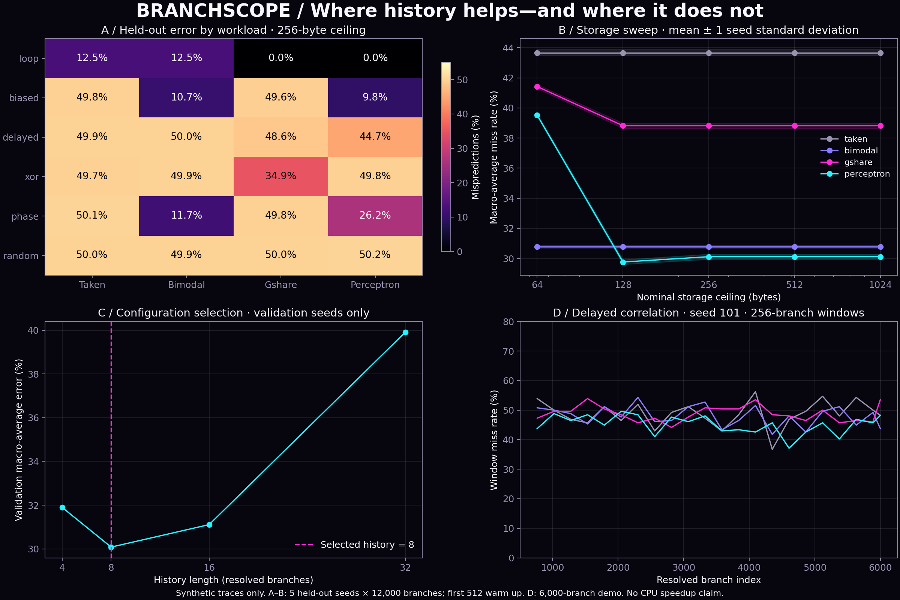
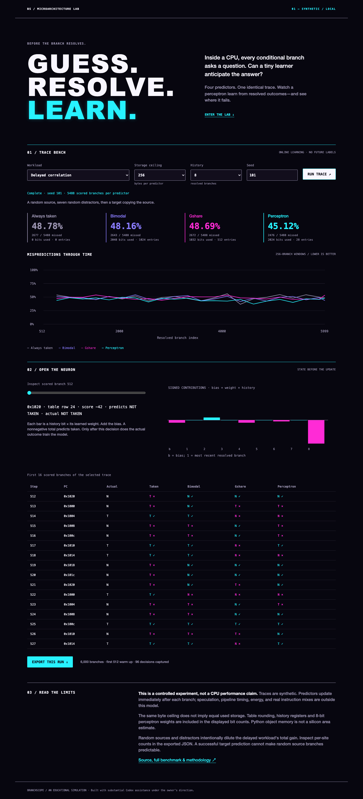

# Problem Statement

**Can a small online learner predict conditional CPU branches better than simple counters under a fixed storage ceiling—and where does it fail?**

BranchScope is a local microarchitecture laboratory that generates synthetic branch-address/outcome streams, predicts each outcome before observing it, and compares four predictors on identical traces. Success means lower held-out misprediction rate at a stated storage ceiling, not a claim of faster real hardware. The simulator assumes immediate branch resolution and excludes speculative execution, pipeline stalls, energy and real-program traces.



**A real online-trained perceptron. Six synthetic workload families. No API keys, cloud inference, hardware or runtime dependencies.**

## Start the interactive lab

Python 3.11+ and a browser are sufficient. Tested locally with Python 3.14; CI uses 3.12.

```sh
git clone https://github.com/mirmoosa1014-rgb/branchscope.git
cd branchscope
python3 -m branchscope.server
```

Open **http://127.0.0.1:8765**. Choose a workload, storage ceiling, history length and seed; run all four predictors. Inspect the first 96 scored decisions, scrub the perceptron's signed contributions, and export the actual run as JSON. Stop the server with Ctrl+C. The repository itself does not host a running website.



## Measured findings

Full run: **600 evaluations**, six workload families, five held-out seeds (101–105), five byte ceilings, four predictors. Each trace has 12,000 branches; the first 512 warm up the predictor. History length **8** was selected using only seeds 11–13 at the 256-byte ceiling. The same selected length is used throughout the test sweep. Each test trace starts a fresh model, which continues learning after each scored prediction.

Mean misprediction rates across the five test seeds at a **256-byte ceiling**:

| Workload | Always taken | Bimodal | Gshare | Perceptron |
|---|---:|---:|---:|---:|
| loop | 12.50% | 12.50% | 0.00% | 0.02% |
| biased | 49.84% | 10.70% | 49.59% | 9.78% |
| delayed | 49.86% | 49.99% | 48.60% | 44.69% |
| xor | 49.69% | 49.90% | 34.93% | 49.77% |
| phase | 50.14% | 11.68% | 49.82% | 26.20% |
| random | 49.98% | 49.88% | 49.98% | 50.25% |

- Delayed correlation: the perceptron makes fewer errors than both counter baselines, but random source/distractor branches still dominate overall error.
- XOR: gshare performs better. This deliberately exposes a limitation of a linear learner.
- Phase reversal: bimodal adapts better here; learned confidence can become a liability when biases reverse.
- Random control: all methods remain near 50%. There is no universal winner.

These are **synthetic benchmark results**, not SPEC results, silicon measurements or speedups. All rates, seeds, storage bits and raw counts are in [CSV](results/benchmark.csv) and [JSON](results/benchmark.json). Figure bands show one sample standard deviation across seed-level macro averages, **not confidence intervals**. See [evaluation](docs/evaluation.md).

## Reproduce and test

```sh
python3 -m unittest discover -s tests -v    # core, API and saved-artifact checks
python3 -m branchscope.experiment --quick # smaller smoke benchmark; artifacts/quick
python3 -m branchscope.experiment         # full benchmark; replaces results and model snapshot
```

Optional plot generation (the app and simulator do not need these packages):

```sh
python3 -m venv .venv
.venv/bin/python -m pip install -r requirements-figures.txt
.venv/bin/python scripts/figures.py
```

Optional real-browser checks, with the server running in another terminal:

```sh
npm ci
npx playwright install chromium
npm run test:browser
```

Browser tests rerun the live simulation, change workload/seed, inspect a neuron, download and check JSON, test mobile overflow and reduced motion, and capture real screenshots. The pinned browser dependency is development-only. GitHub Actions runs unit/integration tests, the quick benchmark and Chromium verification.

## What is implemented

- Always-taken control, two-bit bimodal counters, XOR-indexed gshare and saturating 8-bit perceptron weights.
- Address-indexed tables with real collisions, explicit history registers and storage accounting under each ceiling.
- Online training after outcome resolution, deterministic paired seeds, disjoint validation/test seeds and bounded input sizes.
- A live loopback API, accessible keyboard controls, scrollable trace table, JSON export and mobile layout.
- A [trained snapshot](models/demo-perceptron.json) from the saved demo. It documents learned state; evaluation never starts from this snapshot.

## Read further

[Architecture](docs/architecture.md) · [Model card](docs/model.md) · [Evaluation](docs/evaluation.md) · [Plain-language explanation](docs/explain.md) · [90-second demo](docs/demo.md) · [Project summary](docs/project-summary.md) · [Design provenance](docs/design.md)

The perceptron mechanism follows the educational formulation in Jiménez and Lin, [Dynamic Branch Prediction with Perceptrons (HPCA 2001)](https://www.cs.utexas.edu/~lin/papers/hpca01.pdf). This project is an independent small simulator, not a reproduction of that paper's hardware design or performance results.

## Contributions and license

The repository owner supplied the portfolio goals, project constraints and publication direction. Codex selected this scoped idea and substantially implemented the code, experiments, tests, documentation and visual demonstration. No additional owner implementation or review is claimed. MIT licensed; visual inspiration is credited in [design.md](docs/design.md).
